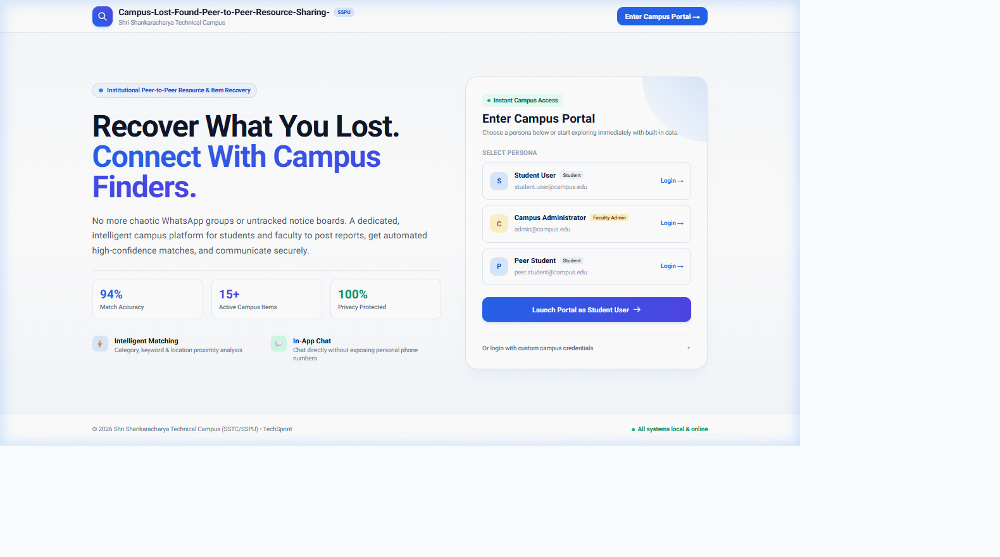
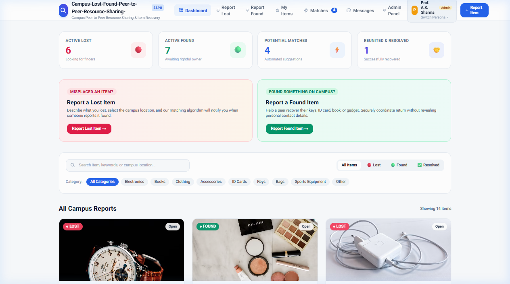
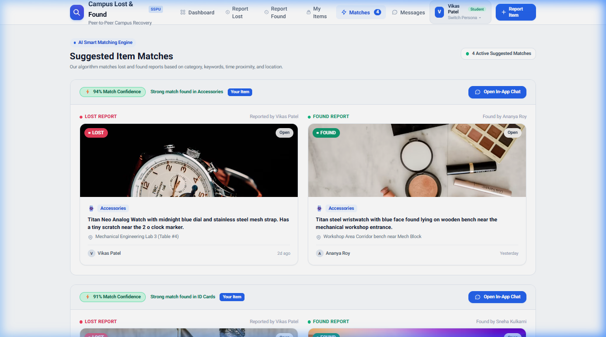
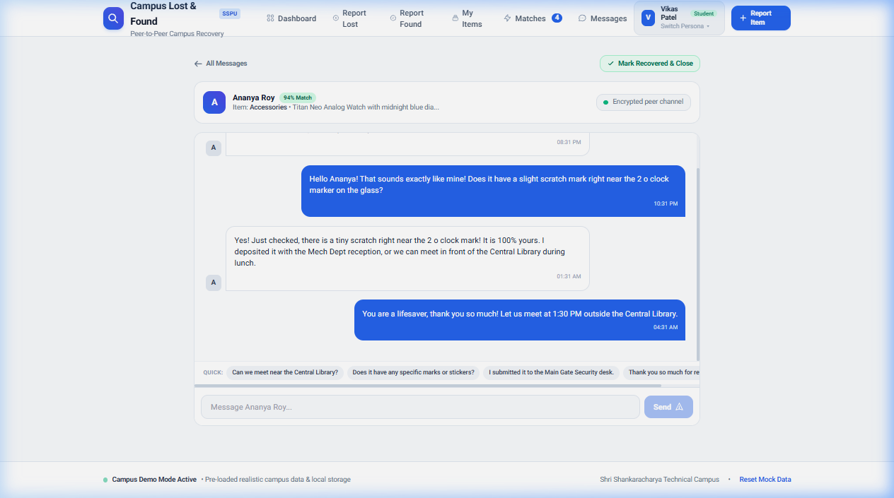
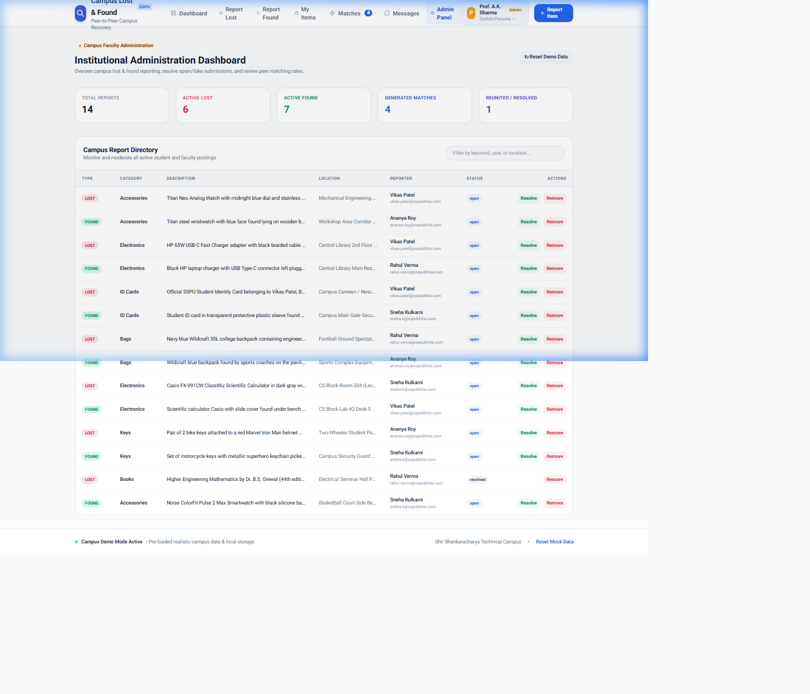

# Campus-Lost-Found-Peer-to-Peer-Resource-Sharing-

<p align="center">
  
</p>

<p align="center">
  
  
  
  
  
  
</p>

---

## 📖 Overview

**Campus-Lost-Found-Peer-to-Peer-Resource-Sharing-** is a modern, light-theme peer-to-peer web application designed for university and college campuses. It provides a centralized, private portal for students, faculty, and campus administrators to report lost belongings, log found items, discover automated high-confidence matches, and coordinate returns via secure in-app messaging.

### 🌟 Key Highlights
- ⚡ **Zero Backend Setup Required**: Runs 100% locally with built-in realistic mock data and browser `localStorage` persistence.
- 🎨 **Modern Light Theme Aesthetic**: Clean typography (*Plus Jakarta Sans* & *Inter*), soft shadows, electric blue accents, and intuitive badges.
- 🚀 **No Google Sign-In Needed**: Direct one-click login via pre-configured personas (**Student User**, **Campus Administrator**, **Peer Student**) or custom campus credentials.
- 🧠 **Intelligent AI Matching**: Automated weighted scoring comparing categories, keyword overlaps, time proximity, and location proximity.
- 💬 **Private Peer-to-Peer Chat**: In-app encrypted messaging so finders and owners can verify items without sharing personal phone numbers.
- 🛡️ **Institutional Admin Portal**: Live report directory, metrics counters, and moderation tools.

---

## 📸 Visual Tour & Features

### 1. Instant Campus Access & Persona Selection
Access the portal with a single click without setting up external OAuth credentials. Toggle between Student and Campus Administrator personas to test all user roles.

<p align="center">
  
</p>

- **Instant 1-Click Access**: Enter as `Student User` or `Campus Administrator`.
- **Custom Campus Credentials**: Optional form to test with any name and campus email.
- **Privacy First**: Domain-level security concept without external tracking.

---

### 2. Central Campus Dashboard
An organized overview of all campus activity with quick search and category filters.

<p align="center">
  
</p>

- **Live Activity Metrics**: Real-time counts for Active Lost, Active Found, Generated Matches, and Reunited Items.
- **Search & Filter Suite**: Filter instantly by report type (*All, Lost, Found, Resolved*) or item category (*Electronics, Bags, ID Cards, Keys, Books, Accessories*).
- **Rich Visual Cards**: Detailed item cards with location pins, reporter badges, time elapsed, and high-resolution visuals.

---

### 3. AI-Powered Smart Matching Engine
Eliminates manual searching by automatically computing compatibility scores between lost and found reports.

<p align="center">
  
</p>

- **Weighted Confidence Scoring**:
  - **Category Match**: 40 points
  - **Description Keyword Overlap**: Up to 40 points
  - **Time & Date Proximity**: Up to 20 points
- **Side-by-Side Comparison**: Visually inspect the lost item against the found candidate before initiating contact.
- **Direct Chat Launcher**: Jump directly into a dedicated conversation thread.

---

### 4. Encrypted Peer-to-Peer Chat
Coordinate recoveries safely within the campus network.

<p align="center">
  
</p>

- **Item Context Header**: Displays the matched items, category, and match percentage right in the chat.
- **Quick Reply Suggestions**: Pre-set campus responses (*"Can we meet near the Central Library?"*, *"I submitted it to security"*).
- **One-Click Recovery**: Mark the item as recovered directly from the conversation.

---

### 5. Institutional Administration Dashboard
Faculty and security administration view for platform oversight and moderation.

<p align="center">
  
</p>

- **Platform-Wide Stats**: Track resolution and recovery rates across campus departments.
- **Moderation Table**: Review, resolve, or delete spam and duplicate postings.
- **Demo Data Reset**: Reset the entire mock dataset back to factory defaults at any time.

---

## 🛠️ Tech Stack

| Layer | Technologies |
|---|---|
| **Framework** | [Next.js 14 (App Router)](https://nextjs.org/) |
| **UI Library** | [React 18](https://react.dev/) |
| **Language** | [TypeScript 5.3](https://www.typescriptlang.org/) |
| **Styling** | [Tailwind CSS 3.4](https://tailwindcss.com/) with custom light theme tokens |
| **Typography** | Plus Jakarta Sans & Inter (Google Fonts) |
| **State & Storage** | LocalStorage + Reactive Store Event Bus ([`lib/mockStore.ts`](./lib/mockStore.ts)) |

---

## 🚀 Quick Start (Run Locally)

### Prerequisites
- [Node.js](https://nodejs.org/) (v18.0.0 or higher recommended)
- `npm` or `yarn`

### Installation & Launch

1. **Navigate to the application directory:**
   ```bash
   cd Campus-Lost-Found-main/Campus-Lost-Found-main
   ```

2. **Install project dependencies:**
   ```bash
   npm install
   ```

3. **Start the local development server:**
   ```bash
   npm run dev
   ```

4. **Open in browser:**
   ```
   http://localhost:3000
   ```

> [!NOTE]
> No backend, database, or API keys are required. The project initializes with built-in realistic fake data automatically.

---

## 🗂️ Project Structure

```plaintext
Campus-Lost-Found-main/
└── Campus-Lost-Found-main/
    ├── app/
    │   ├── admin/             # Faculty Admin Dashboard & Moderation
    │   ├── chat/[matchId]/    # Dedicated In-App Chat Interface
    │   ├── dashboard/         # Main Campus Reports Directory
    │   ├── matches/           # AI Potential Matches Engine
    │   ├── messages/          # Active Conversation Threads
    │   ├── my-items/          # Personal Item Management
    │   ├── report/
    │   │   ├── lost/          # Report Lost Item Form
    │   │   └── found/         # Report Found Item Form
    │   ├── globals.css        # Base Styles & Custom Utilities
    │   ├── layout.tsx         # Root Layout & Metadata
    │   └── page.tsx           # Modern Landing Page & Persona Selector
    ├── components/
    │   ├── DashboardLayout.tsx # Navigation Header, Persona Switcher & Footer
    │   ├── ItemCard.tsx       # Reusable Item Display Card
    │   └── ProtectedRoute.tsx # Route Guard & Loading Spinner
    ├── contexts/
    │   └── AuthContext.tsx    # Mock Auth & Persona Switcher Context
    ├── lib/
    │   ├── matching.ts        # Match Scoring Algorithm
    │   └── mockStore.ts       # Built-in Fake Data & LocalStorage Store
    ├── public/
    │   └── docs/              # High-Resolution UI Screenshots
    ├── tailwind.config.js     # Custom Light Theme Palette
    └── package.json           # Project Configuration & Scripts
```

---

## 👥 Built-in Personas

| Persona | Role | Default Email | Access Scope |
|---|---|---|---|
| **Student User** | Student | `student.user@campus.edu` | Report items, view matches, chat with finders |
| **Campus Administrator** | Faculty Admin | `admin@campus.edu` | Full administrative oversight, moderation, item removal |
| **Peer Student** | Student | `peer.student@campus.edu` | Campus finder profile with active matched reports |

---

## 📄 License
This project is open-source and intended for academic, hackathon, and educational demonstration purposes.
